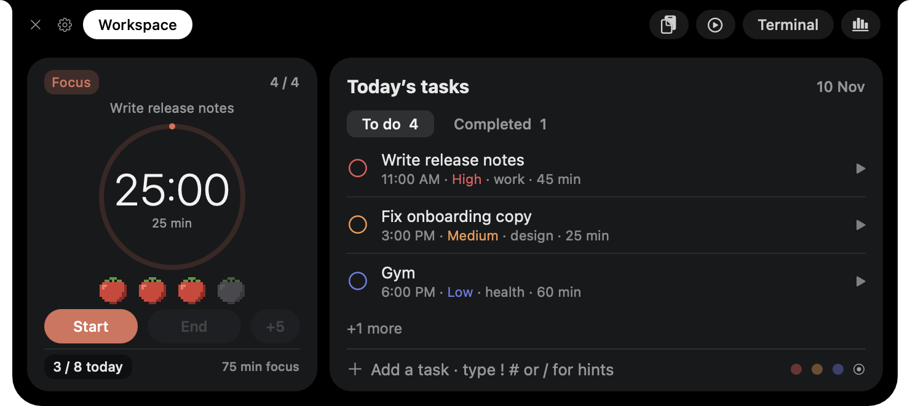
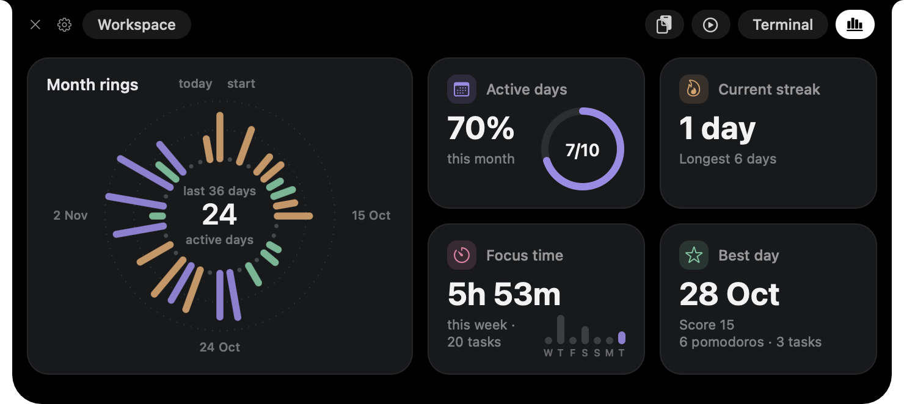

# NotchGo

A small native macOS app that lives in the MacBook notch: today's tasks, a focus timer, insights and quick capture, one hover away.

[](https://github.com/miphu2804/notchpad/releases/latest)


[](LICENSE)

<p align="center">
  
  
</p>

**Contents:** [Features](#features) · [Install](#install) · [Usage](#usage) · [Integrations](#integrations) · [Privacy](#privacy) · [Development](#development)

## Features

Each section is a tab in the open notch; hide or resize any of them in **Settings › Sections**.

| Section | What it holds |
|---|---|
| **Workspace** | Today's tasks with one-line quick add and undo, a pomodoro timer tied to a task, and today's calendar events. |
| **Insights** | Month rings of the last 36 days, active days this month, current streak, focus time this week and the best day. |
| **Clips** | Clipboard history, fresh screenshots and dropped files, ready to drag into any app. |
| **Playing** | Now Playing with artwork, progress and playback controls. |
| **Terminal** | A shell in the notch. |

Around the sections:

- **Alerts** drop out of the notch when a focus session or break ends and before a timed task, with Snooze and Done.
- **Live wings** beside the closed notch show the current track and the focus countdown.
- **Integrations** with Claude (MCP), Calendar, Linear, Apple Reminders and Shortcuts. See [Integrations](#integrations).

## Install

Requires macOS 14 or later. The release build is for Apple Silicon; build from source for an Intel Mac. On a display without a notch, NotchGo draws its own.

**Release.** Download the zip from the [latest release](https://github.com/miphu2804/notchpad/releases/latest), unzip it and drag **NotchGo.app** into **Applications**. The app is not notarized, so macOS blocks the first launch: open **System Settings › Privacy & Security** and click **Open Anyway**, or run:

```bash
xattr -dr com.apple.quarantine /Applications/NotchGo.app
```

**From source.** Needs a Rust toolchain (edition 2024) and the Xcode command line tools.

```bash
./macos/bundle.sh --install
```

This builds `NotchGo.app` and replaces `/Applications/NotchGo.app`. It is signed with your first Apple Development identity if one exists, otherwise ad hoc; ad-hoc builds make macOS ask for permissions again after each rebuild.

To start at login, turn on **Settings › General › Open at login**.

## Usage

Hover the notch or press **Option-N** to open it; quit with the ✕. Right-click the header for **Plan the rest of today** (gives today's untimed tasks a start in the free gaps until 22:00, high priority first, around calendar events and timed tasks), Insights, the JSON backup export and copying today's tasks as a Markdown checklist.

Quick add reads one line; recognised words set fields and are removed from the title:

| Syntax | Meaning |
|---|---|
| `5pm`, `17:30`, `5:30pm`, `9h30` | time |
| `!high` `!med` `!low` (or `!!!` `!!` `!`) | priority |
| `#project` | project |
| `30m`, `45min`, `~1h`, `~1.5h` | time estimate |
| `today`, `tomorrow`, `tmr` | day (default: today) |

Example: `gym 6pm !high #health 45m tomorrow`. Typing `!`, `#` or `/` shows completions; Up/Down choose and Tab accepts.

## Integrations

All integrations are off until you turn them on in **Settings › Integrations**.

| Integration | What it does | Access |
|---|---|---|
| [Claude](#claude-code-and-desktop) | Claude reads, adds and plans your tasks through MCP | One-click Add for Claude Code or Claude Desktop |
| [Calendar](#calendar) | Today's events above your tasks, read-only | macOS Calendars permission |
| [Linear](#linear) | Assigned issues become tasks; done in NotchGo closes them | OAuth or a personal API key, kept in the Keychain |
| [Reminders](#apple-reminders) | Two-way sync with a "NotchGo" list, so tasks reach iPhone and Watch | macOS Reminders permission |
| [Shortcuts](#shortcuts-and-automation) | Add tasks from a shell command or an automation | None |

### Claude (Code and Desktop)

The bundled MCP server `notchpad-mcp` lets Claude read and manage your tasks (`list_tasks`, `add_task`, `complete_task`, `move_task`, `update_task`, `plan_day`). Ask it to "plan my afternoon" and `plan_day` turns the request into timed, prioritised tasks.

The **Add** buttons register the server: for Claude Code with `claude mcp add --scope user`; for Claude Desktop by merging into `claude_desktop_config.json` (a `.bak` is kept and a file that is not valid JSON is never overwritten), then restart Claude Desktop.

Tasks live in `~/Library/Application Support/notchpad/tasks.txt`, one tab-separated line per task; the app reloads it within about 2 seconds of an external write. Tasks added without a day go to the Inbox, which the notch does not show; `move_task` or `plan_day` brings them into today.

### Calendar

**Show calendar events** lists today's remaining events above your tasks; finished events drop off. Events come from the macOS calendars (EventKit), so add Google or other accounts in **System Settings › Internet Accounts**. NotchGo never writes to a calendar.

### Linear

Under **Settings › Integrations › Linear**, either:

- click **Connect** to authorize in the browser with OAuth, or
- paste a personal API key from **Linear › Settings › Security & access** (offered when the build has no OAuth client ID). **Connect** with the field empty opens that page.

Your open assigned issues become tasks on their due date (or today), refreshed at launch and every 10 minutes. Completing one in NotchGo moves the issue to its team's completed state.

### Apple Reminders

**Sync tasks with Reminders** keeps your tasks in step with a Reminders list named "NotchGo", which iCloud carries to iPhone and Apple Watch.

- Title, day, time, priority, project (as a `#tag` line in the notes) and completion sync; Inbox tasks become reminders without a due date.
- Only local tasks sync; Linear tasks keep their own sync.
- Changes arrive as soon as Reminders reports them, with a 30-second check as a fallback.
- When both sides changed, the side edited last wins, and a completion on either side is always kept.
- Deleting an open task on either side deletes it on the other. Clearing completed reminders on the phone keeps the done tasks in NotchGo's history.

### Shortcuts and automation

`notchpad-mcp add` adds a task using the quick-add syntax. It goes to today unless the line names another day.

```bash
/Applications/NotchGo.app/Contents/MacOS/notchpad-mcp add "Pay rent 5pm !high #home"
```

In Shortcuts, turn on **Settings › Advanced › Allow Running Scripts**, add a **Run Shell Script** action with that command and pass your text as an argument.

With a personal automation this turns incoming mail or messages into tasks: on macOS Tahoe, trigger on **Email** or **Message**, filter by sender or subject (for example, your bank's transaction emails), then run the command with a line such as `Review transaction #finance`. Shortcuts has no "any notification" trigger, so only its listed triggers work.

## Privacy

Everything stays on your Mac, as plain text in `~/Library/Application Support/notchpad/`. NotchGo makes network requests only to Linear, and only if you connect it. Calendar, Reminders and Music/Spotify access are requested from macOS only when the feature is used.

## Development

```bash
cargo build --release   # produces notchpad (app) and notchpad-mcp (MCP server)
cargo test
```

<details>
<summary>Source layout</summary>

- `main.rs`, `controller.rs`, `panel.rs`: app entry, notch window and event handling.
- `store.rs`, `days.rs`, `quick_add.rs`: task file, day keys and the quick-add parser.
- `settings*.rs`, `insights*.rs`, `calendar.rs`, `linear.rs`, `reminders*.rs`, `claude_mcp.rs`: settings, Insights and integrations.
- `terminal_*.rs`, `now_playing.rs`, `clips.rs`: terminal, Now Playing and clips.
- `bin/notchpad-mcp.rs`: MCP server and the `add` command.

</details>

Internal identifiers keep the project's first name, so existing data and permissions carry over: the binaries `notchpad` and `notchpad-mcp`, the bundle ID `app.notchpad`, the data folder and the MCP server name `notchpad`.

To embed a Linear OAuth client ID, register a public application in Linear with the redirect URI `http://127.0.0.1:53682/oauth/callback` and build with `NOTCHPAD_LINEAR_CLIENT_ID='<client-id>' ./macos/bundle.sh --install`. Never embed a client secret.

## Contributing

See [CONTRIBUTING.md](CONTRIBUTING.md). To report a vulnerability, see [SECURITY.md](SECURITY.md).

## License

[MIT](LICENSE).
